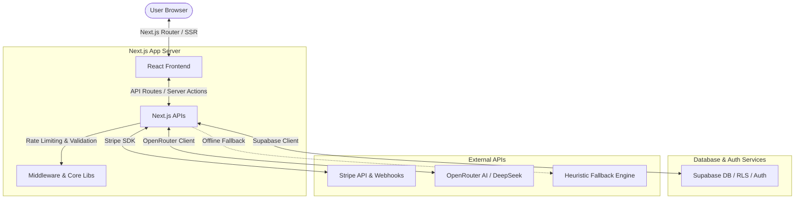
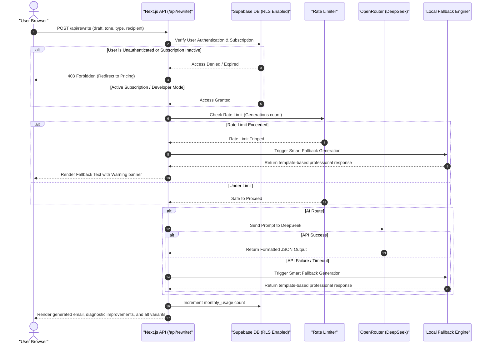

# ✉️ ProComm — Business-Professional AI Communication Assistant

ProComm is an enterprise-grade AI writing assistant that transforms raw, emotional, or unstructured drafts into clean, professional, and tonally precise communication. Powered by **Next.js 15**, **Supabase**, **Stripe**, and **OpenRouter (DeepSeek AI)**, ProComm ensures your messages convey credibility, respect, and confidence before you hit send.

---

## 🚀 Key Features

*   **AI-Powered Tone Transformation**: Translates your draft into presets (Professional, Diplomatic, Firm, Sarcastic) or a completely custom tone.
*   **Smart Context Customization**: Supports specifying **Communication Type** (Email, Slack, Performance Feedback) and **Recipient Context** (Manager, Colleague, Client) for highly tailored output.
*   **Detailed AI Diagnostic Insights**: Displays a curated list of specific improvements made (e.g., softening, correcting syntax, removing high-pressure demands).
*   **Multi-Version Variants**: Automatically generates alternative drafts in secondary tones, allowing users to compare and hot-swap drafts with one click.
*   **Intelligent Local Fallback Engine**: A robust heuristic fallback engine that detects original tones and generates smart template responses in case of API rate limits or lack of API keys.
*   **Google OAuth Integration**: Streamlined social authentication option via Supabase Auth.
*   **Usage & Subscription Limits**: Track user generations against monthly quotas with dynamic progress bars on user profiles.
*   **Admin Dashboard**: Full administration panel to manage pricing plans, inspect user stats, and audit active subscriptions.

---

## 🏛️ System Architecture & Data Flow

ProComm features a highly decoupled, serverless-first architecture using Next.js API Routes, Supabase Database, Stripe Billing, and OpenRouter AI.

### System Topology



### Request Lifecycle (`/api/rewrite`)

The sequence diagram below details how the rewrite request is validated, rate-limited, routed to AI (or intercepted by the Fallback Engine), and tracked:



---

## 📂 Project Structure

```text
procomm/
├── app/                      # Next.js 15 App Router
│   ├── admin/                # Admin Panel pages
│   ├── api/                  # Backend endpoints (rewrite, checkout, webhook)
│   ├── auth/                 # OAuth callback routing
│   ├── login/                # Email/Password + Google Login page
│   ├── signup/               # Email/Password + Google Signup page
│   ├── globals.css           # Global stylesheets & design design tokens
│   └── page.js               # Application home dashboard
├── src/
│   ├── components/           # UI Elements
│   │   ├── layout/           # Sidebar, Navbar, BaseLayout
│   │   └── rewrite/          # Rewrite Form, Output Cards, Selectors
│   └── lib/                  # Business Logic & Utility Modules
│       ├── ai/               # OpenRouter client & Fallback heuristics engine
│       ├── supabase/         # Client & Server DB initialization
│       ├── env.js            # Standardized environment validation
│       ├── rate-limit.js     # Redis/DB rate limit helpers
│       ├── stripe.js         # Stripe integration SDK wrapper
│       └── telemetry.js      # Logger & audit metrics helper
├── supabase/                 # Supabase configuration & templates
│   ├── templates/            # Customized glassmorphic auth email templates
│   └── seed.sql              # Core schema rules
```

---

## 🗄️ Database Schema (Supabase)

ProComm relies on a relational schema in Postgres managed via Supabase. Below are the key tables:

### 1. `profiles`
Tracks user identification metadata. Automatically populated via database triggers when an authentication account is created.
*   `id` (`uuid`, Primary Key) -> References `auth.users.id`
*   `email` (`text`, Unique)
*   `name` (`text`)
*   `role` (`text`) -> Defaults to `user` (supports `admin`)
*   `updated_at` (`timestamp`)

### 2. `subscriptions`
Tracks customer billing plans and usage limits.
*   `user_id` (`uuid`, Primary Key) -> References `profiles.id`
*   `stripe_customer_id` (`text`)
*   `stripe_subscription_id` (`text`)
*   `plan` (`text`) -> e.g. `monthly`, `annual`, `admin`
*   `status` (`text`) -> e.g. `active`, `cancelled`, `unpaid`
*   `monthly_usage` (`integer`) -> Tracks count of generations in current billing cycle
*   `usage_reset_at` (`timestamp`)
*   `current_period_start` (`timestamp`)
*   `current_period_end` (`timestamp`)

### 3. `pricing_plans`
Stores pricing catalog metadata rendered dynamically on the pricing dashboard.
*   `id` (`uuid`, Primary Key)
*   `name` (`text`, Unique)
*   `price` (`text`)
*   `period` (`text`) -> `/month` or `/year`
*   `description` (`text`)
*   `features` (`text[]`)
*   `is_popular` (`boolean`)
*   `is_active` (`boolean`)
*   `usage_limit` (`integer`, Nullable) -> Limit of generations allowed per month

---

## 🛠️ Setup & Installation

### Prerequisites
*   [Node.js](https://nodejs.org/) (v18.x or later)
*   [Supabase CLI](https://supabase.com/docs/guides/local-development/cli/installation)
*   [Stripe CLI](https://stripe.com/docs/stripe-cli)

### Step 1: Clone the Repository
```bash
git clone https://github.com/DeepParekh9190/ProComm---AI-Email-Generations.git
cd ProComm---AI-Email-Generations
```

### Step 2: Configure Environment Variables
Create a `.env.local` file in the root directory:
```ini
# Supabase Configuration
NEXT_PUBLIC_SUPABASE_URL=http://127.0.0.1:54321
NEXT_PUBLIC_SUPABASE_ANON_KEY=your-supabase-anon-key
SUPABASE_SERVICE_ROLE_KEY=your-supabase-service-role-key

# OpenRouter (AI Provider)
OPENROUTER_API_KEY=your-openrouter-key

# Stripe Configurations
STRIPE_SECRET_KEY=sk_test_...
STRIPE_WEBHOOK_SECRET=whsec_...
```

### Step 3: Run Database Migrations & Seed Local Auth
Initialize the Supabase local environment:
```bash
supabase start
```
Seed the testing accounts and plans inside the database:
```bash
npm run db:seed
```
*Note: This creates local users for debugging: `admin@procomm.ai` (Password: `Admin@123456!`) and `testuser@test.com` (Password: `Test@123456`).*

### Step 4: Configure Google OAuth (Optional)
To test Google OAuth login:
1. Go to your **Supabase Dashboard** > **Authentication** > **Providers** > **Google**.
2. Input your Google Client ID and Secret obtained from Google Cloud Console.
3. Configure the redirect URL: `https://<your-project-ref>.supabase.co/auth/v1/callback` or `http://localhost:54321/auth/v1/callback` for local development.

### Step 5: Install Dependencies & Run App
```bash
npm install
npm run dev
```
Open `http://localhost:3000` to interact with the application.

---

## 💳 Local Stripe Integration & Webhook Handling

To test the payment checkout flow locally:
1. Start the Stripe local listener to forward events:
   ```bash
   stripe listen --forward-to localhost:3000/api/webhook
   ```
2. Copy the printed webhook signing secret (`whsec_...`) and update `STRIPE_WEBHOOK_SECRET` in `.env.local`.
3. Perform a payment request on the Pricing page using test credentials.

### Development Mode Bypass
To ease engineering productivity in local development environments, you can bypass the Stripe payment flow:
*   If `process.env.NODE_ENV !== "production"`, a **Development Mode Banner** appears on `/pricing`.
*   Click the **"Bypass Pricing & Go to Dashboard"** button to automatically activate a mock developer subscription on the local database without making Stripe network requests.

---

## 🛡️ Intelligent Local Fallback Engine

When OpenRouter API keys are missing, network connectivity is lost, or API rate limits are hit, ProComm automatically transitions to its local heuristic engine:

1.  **Original Tone Detection**: Uses substring and punctuation heuristics to analyze raw user input and determine if the draft is *Aggressive*, *Impatient*, *Apologetic*, *Polite*, *Abrupt*, or *Informal*.
2.  **Smart Template Matching**: Automatically detects request themes (e.g. *Delay notifications*, *Delay requests*, *Apologies*, *Meeting schedules*, *Request templates*, *System outages*) to map the input to pre-configured formal business email formats.
3.  **Graceful UI Alerts**: Displays a subtle banner indicating the output was compiled using the local fallback engine, preserving a seamless, uninterrupted workflow.

---

## 📧 Transactional Custom Templates
Supabase Auth transaction templates (confirmation and password recovery) are updated inside the `supabase/templates` directory. They are designed using fully responsive, modern glassmorphic HTML components containing corporate-blue envelope headers.
*   **Sign up confirmation email**: `supabase/templates/confirm.html`
*   **Password recovery email**: `supabase/templates/password-reset.html`

---

## 📝 License
This project is licensed under the MIT License. See [LICENSE](LICENSE) for details.
