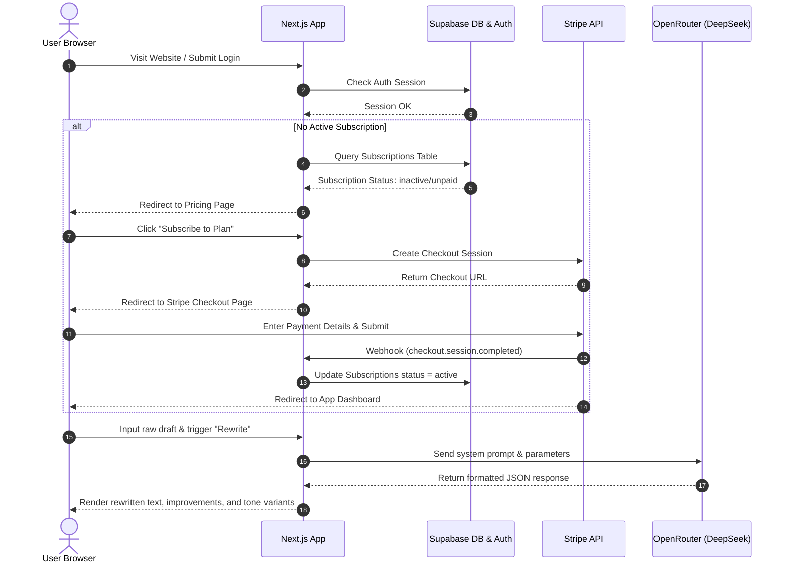

# ✉️ ProComm — Business-Professional AI Communication Assistant


ProComm is an enterprise-grade AI writing assistant that transforms raw, emotional, or unstructured drafts into clean, professional, and tonally precise communication. Powered by Next.js 15, Supabase, Stripe, and OpenRouter (DeepSeek AI), ProComm ensures your messages convey credibility, respect, and confidence before you hit send.

---

## 🚀 Key Features

- **AI-Powered Tone Transformation**: Translates your draft into presets (Professional, Diplomatic, Firm, Sarcastic) or a completely custom tone.
- **Smart Context Customization**: Supports specifying **Communication Type** (Email, Slack, Performance Feedback) and **Recipient Context** (Manager, Colleague, Client) for highly tailored output.
- **Detailed AI Diagnostic Insights**: Displays a curated list of specific improvements made (e.g., softening, correcting syntax, removing high-pressure demands).
- **Multi-Version Variants**: Automatically generates alternative drafts in secondary tones, allowing users to compare and hot-swap drafts with one click.
- **Intelligent Local Fallback Engine**: Includes a heuristic fallback engine that generates smart template responses and detects original tones in case of API rate limits or lack of API keys.
- **Usage & Subscription Limits**: Track user generations against monthly quotas with dynamic progress bars on user profiles.
- **Admin Dashboard**: Full administration panel to manage pricing plans, inspect user stats, and audit active subscriptions.

---

## 🏛️ Architecture & System Flow



---

## 🗄️ Database Schema (Supabase)

ProComm relies on a relational schema in Postgres managed via Supabase. Below are the key tables:

### 1. `profiles`

Tracks user identification metadata. Automatically populated via database triggers when an authentication account is created.

- `id` (`uuid`, Primary Key) -> References `auth.users.id`
- `email` (`text`, Unique)
- `name` (`text`)
- `role` (`text`) -> Defaults to `user` (supports `admin`)
- `updated_at` (`timestamp`)

### 2. `subscriptions`

Tracks customer billing plans and usage limits.

- `user_id` (`uuid`, Primary Key) -> References `profiles.id`
- `stripe_customer_id` (`text`)
- `stripe_subscription_id` (`text`)
- `plan` (`text`) -> e.g. `monthly`, `annual`, `admin`
- `status` (`text`) -> e.g. `active`, `cancelled`, `unpaid`
- `monthly_usage` (`integer`) -> Tracks count of generations in current billing cycle
- `usage_reset_at` (`timestamp`)
- `current_period_start` (`timestamp`)
- `current_period_end` (`timestamp`)

### 3. `pricing_plans`

Stores pricing catalog metadata rendered dynamically on the pricing dashboard.

- `id` (`uuid`, Primary Key)
- `name` (`text`, Unique)
- `price` (`text`)
- `period` (`text`) -> `/month` or `/year`
- `description` (`text`)
- `features` (`text[]`)
- `is_popular` (`boolean`)
- `is_active` (`boolean`)
- `usage_limit` (`integer`, Nullable) -> Limit of generations allowed per month

---

## 🛠️ Setup & Installation

### Prerequisites

- [Node.js](https://nodejs.org/) (v18.x or later)
- [Supabase CLI](https://supabase.com/docs/guides/local-development/cli/installation) (for local database & Edge Functions)
- [Stripe CLI](https://stripe.com/docs/stripe-cli) (for local payment webhook testing)

### Step 1: Clone the Repository

```bash
git clone https://github.com/your-username/procomm.git
cd procomm
```

### Step 2: Configure Environment Variables

Create a `.env.local` file in the root directory using the values from `.env.example`:

```ini
# Supabase Configuration
NEXT_PUBLIC_SUPABASE_URL=http://127.0.0.1:54321
NEXT_PUBLIC_SUPABASE_ANON_KEY=your-supabase-anon-key
SUPABASE_SERVICE_ROLE_KEY=your-supabase-service-role-key

# OpenRouter (AI)
OPENROUTER_API_KEY=your-openrouter-key

# Stripe Configurations
STRIPE_SECRET_KEY=sk_test_...
STRIPE_WEBHOOK_SECRET=whsec_...
```

### Step 3: Run Database Migrations & Seed Local Auth

Initialize the Supabase local environment:

```bash
supabase start
```

Seed the testing accounts and plans inside database:

```bash
npm run db:seed
```

_Note: This creates local users for debugging: `admin@procomm.ai` (Password: `Admin@123456!`) and `testuser@test.com` (Password: `Test@123456`)._

### Step 4: Install Dependencies & Run Next.js

Install npm dependencies and launch the dev environment:

```bash
npm install
npm run dev
```

Open `http://localhost:3000` to interact with the application.

---

## 💳 Local Stripe Integration & Webhook Handling

To test the payment checkout flow locally:

1. Start the Stripe local listener to forward events:
   ```bash
   stripe listen --forward-to localhost:3000/api/webhook
   ```
2. Copy the printed webhook signing secret (`whsec_...`) and update `STRIPE_WEBHOOK_SECRET` in `.env.local`.
3. Perform a payment request on the Pricing page using test card credentials.

### Development Mode Bypass

To ease engineering productivity in local development environments, you can bypass the Stripe payment flow:

- If `process.env.NODE_ENV !== "production"`, a **Development Mode Banner** appears on `/pricing`.
- Click the **"Bypass Pricing & Go to Dashboard"** button to automatically activate a mock developer subscription on the local database without making Stripe network requests.

---

## 📧 Transactional Custom Templates

Supabase Auth transaction templates (confirmation and password recovery) are updated inside the `supabase/templates` directory. They are designed using fully responsive, modern glassmorphic HTML components containing corporate-blue envelope headers.

- **Sign up confirmation email**: `supabase/templates/confirm.html`
- **Password recovery email**: `supabase/templates/password-reset.html`

---

## 📝 License

This project is licensed under the MIT License. See [LICENSE](LICENSE) for details.
